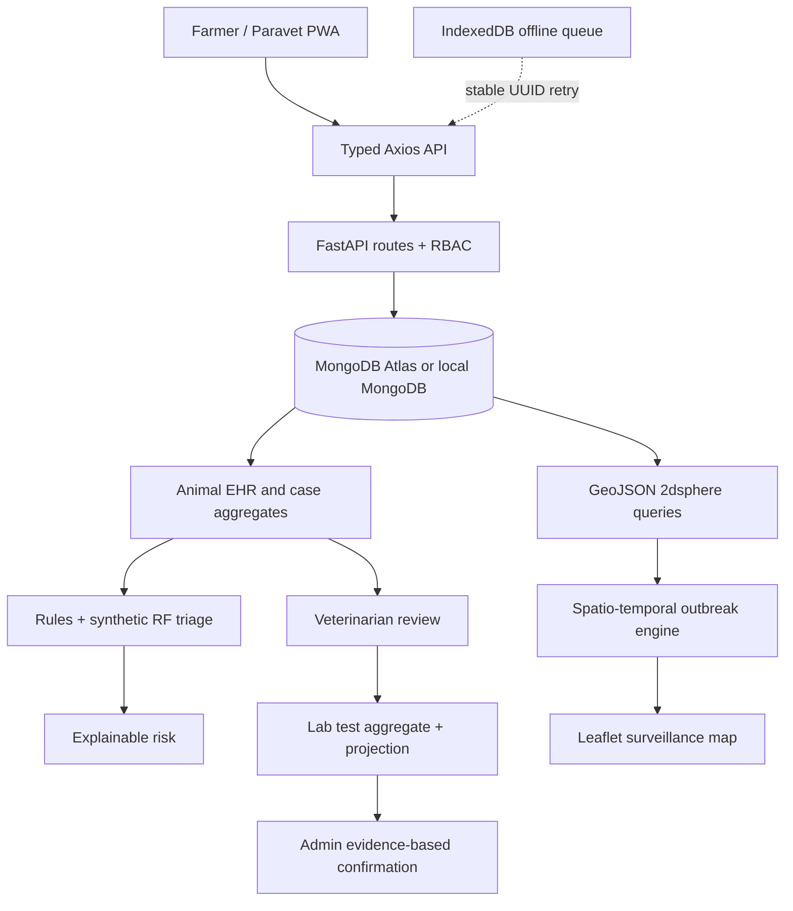

# PashuRaksha architecture

PashuRaksha is a React/Vite/TypeScript PWA backed by FastAPI, Pydantic and PyMongo. MongoDB is the runtime source of truth; tests inject mongomock explicitly. Synthetic data is labelled throughout and no government or external laboratory API is implied.

The backend is split into `auth`, `database`, `schemas`, `routes`, `services`, `triage`, `risk_engine`, `geospatial`, `outbreak` and `notifications`. The frontend separates pages, layouts, reusable components, assessment panels, offline storage/sync, surveillance map and workflow controls.

## Runtime boundaries

JWT sessions use Argon2 password hashes, issuer/audience/expiry checks and server-side revocation. Public registration can create farmers only; professional roles are seeded/provisioned. Every resource is scoped to farmer ownership or district. Lab access is limited to cases linked to tests in that district.

Reports embed their structured observation, immutable animal snapshot, triage, initial/current risk, GeoJSON location, observation and receipt timestamps, lifecycle status and timeline. A unique `(reporter_id, client_report_id)` index makes retries safe. Identical retries repair projections; a conflicting reuse returns 409.

The risk engine is deterministic and returns integer factor points that sum to the score. The outbreak engine uses latest-per-animal observations, distance, observation time, disease/symptom agreement, growth, local baseline and vaccination context. Cluster confirmation is separate from case confirmation and can only be written by an authorized admin with matching positive lab evidence.

Workflow mutations carry an operation UUID and expected case version. The case aggregate is authoritative; lab tests, animal histories, notifications and audit entries are repairable projections. Final lab results are immutable. The single-worker prototype serializes projections with process locks; production scaling needs distributed leases/transactions.

The PWA service worker caches only the application shell and never caches private API responses. IndexedDB stores per-user animal cache and report queue rows, with optional attachment blobs. Network failures queue reports; reconnect or startup retries use the captured account token, retain 4xx blocks and rely on server UUID uniqueness for final deduplication.

## Data collections and indexes

`users` (unique normalized email), `sessions` (expiry TTL), `animals` (unique simulated Pashu ID, owner and `2dsphere` location), `disease_cases` (report UUID, location `2dsphere`, district/time, animal, risk and status), `lab_tests` (case/status), `outbreak_clusters` (center `2dsphere`), `notifications` (unique event key), `audit_logs` and `media` (uploader/client UUID). GridFS adds `fs.files` and `fs.chunks`; `demo_runs` stores replay progress and `surveillance_runs` stores calculation freshness. `create_indexes()` runs at startup against Atlas or local MongoDB.

## Deployment and honesty

The frontend is Vercel-compatible and the backend can run in a Python container on Render or equivalent. Set `MONGODB_URI`, `MONGODB_DATABASE`, a private `JWT_SECRET`, explicit `CORS_ORIGINS` and `DEMO_MODE=false`. GridFS persists attachments in MongoDB on both local and Atlas deployments. See [deployment](DEPLOYMENT.md) and [offline recovery](OFFLINE.md). No clinical accuracy, real vet availability, live laboratory connectivity, Bharat Pashudhan integration, government submission or messaging integration is claimed.
